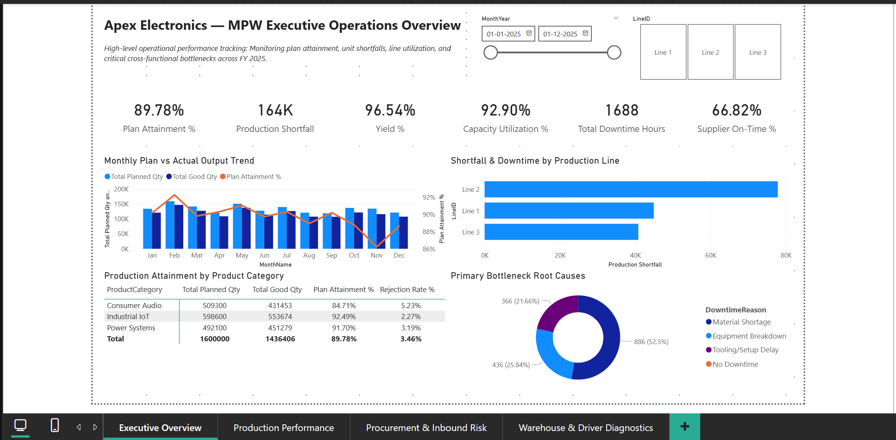
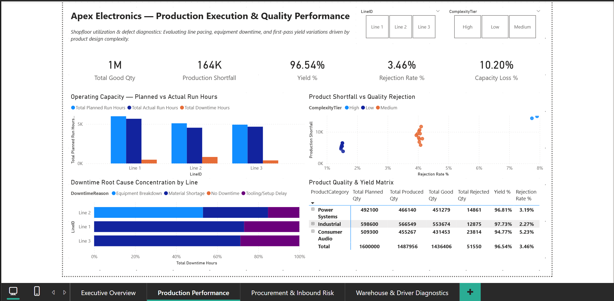
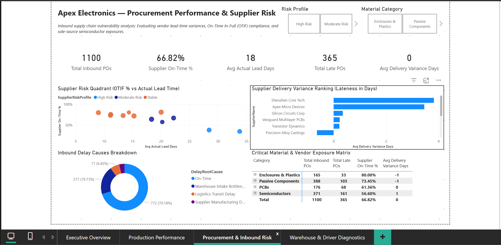
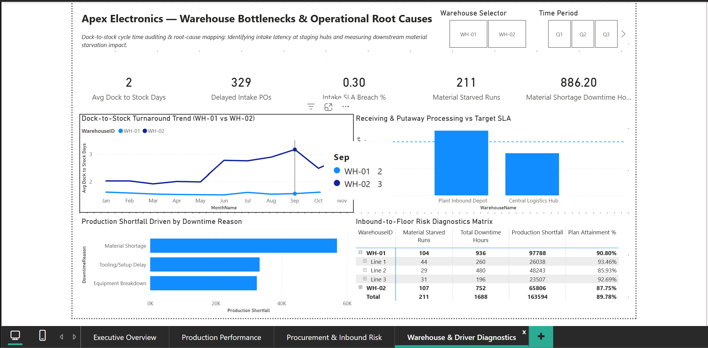

# Manufacturing, Procurement & Warehousing (MPW) Performance Analytics

### Cross-Functional Manufacturing Operations & Supply Chain Analytics Dashboard


---

## Project Overview

This project presents a simulated **Manufacturing, Procurement & Warehousing (MPW) analytics solution** for **Apex Electronics Manufacturing Pvt. Ltd.**, a mid-sized electronics manufacturer.

The analysis investigates why the plant finished FY2025 below its planned production target by examining the operational chain from **supplier delivery and inbound warehousing through production execution and quality yield**.

The objective is not simply to report production KPIs, but to identify the operational constraints behind the production gap and translate those findings into management actions.

### FY2025 headline performance

| KPI | Result |
|---|---:|
| Planned Output | **1,600,000 units** |
| Good Output | **1,436,406 units** |
| Production Shortfall | **163,594 units** |
| Plan Attainment | **89.78%** |
| First-Pass Yield | **96.54%** |
| Rejected Units | **51,550** |
| Downtime | **1,688.0 hours** |
| Supplier On-Time Delivery | **65.82%** |
| Avg. Dock-to-Stock | **1.94 days** |

> **Core business question:** What operational constraints are driving the plant's production shortfall, and where should management intervene first?

---

## Business Context

Apex Electronics operates:

- **1** assembly plant
- **3** SMT production lines
- **2** inbound warehouses
- **20** finished products
- **40** raw materials
- **12** suppliers
- **FY2025** operational data

The analysis focuses on four connected operational areas:

**Procurement → Warehouse Intake → Production Execution → Quality**

The project deliberately uses a compact analytical model rather than attempting to reproduce a full ERP data architecture. The priority is to demonstrate **business analysis, Power BI modeling, DAX, visualization and operational storytelling**.

---

## Business Objectives

Management needs to:

1. Measure production performance against plan.
2. Identify the production lines and products contributing most to shortfall.
3. Quantify downtime and its major operational causes.
4. Evaluate supplier delivery reliability and lead-time variance.
5. Assess inbound warehouse processing performance.
6. Identify material-starvation exposure.
7. Translate the findings into prioritized operational actions.

---

## Key Business Questions

### Manufacturing

- Is the plant meeting planned output?
- Which production lines contribute most to the shortfall?
- Which products show the weakest plan attainment?
- How much scheduled capacity is being lost to downtime?
- How much output is lost through rejection?

### Procurement

- Which suppliers consistently deliver late?
- Which suppliers have the largest delivery variance?
- Are critical materials exposed to supplier reliability risk?

### Warehousing

- How long does inbound material take to become available after receipt?
- Which warehouse has the greater intake bottleneck?
- How frequently does inbound processing exceed the operating benchmark?

### Cross-Functional Operations

- How significant is material starvation as a production constraint?
- Which operational issues should management prioritize first?

---

## Data & Analytical Model

The project uses a compact **two-fact star schema** with shared business dimensions.

### Fact tables

- `Fact_ProductionRun` — production execution, output, rejection, runtime and downtime.
- `Fact_InboundProcurement` — supplier delivery, lead time and inbound warehouse processing.

### Dimensions

- `Dim_Date`
- `Dim_Product`
- `Dim_Material`
- `Dim_Supplier`
- `Dim_Warehouse`

The model is designed to support cross-functional analysis without introducing unnecessary complexity.

Detailed field definitions are available in [`documentation/Data_Dictionary.md`](documentation/Data_Dictionary.md).

---

## Key Performance Indicators

| Area | KPI | Business Logic |
|---|---|---|
| Manufacturing | Plan Attainment % | Good Quantity / Planned Quantity |
| Manufacturing | Production Shortfall | Planned Quantity − Good Quantity |
| Manufacturing | Capacity Utilization % | Actual Run Hours / Planned Run Hours |
| Manufacturing | Downtime Hours | Total recorded production downtime |
| Quality | Yield % | Good Quantity / Produced Quantity |
| Quality | Rejection Rate % | Rejected Quantity / Produced Quantity |
| Procurement | Supplier On-Time % | On-time inbound POs / total inbound POs |
| Procurement | Avg. Actual Lead Days | Average PO-to-receipt lead time |
| Procurement | Avg. Delivery Variance | Actual lead time − contracted lead time |
| Warehouse | Avg. Dock-to-Stock Days | Average receipt-to-availability cycle |
| Warehouse | Warehouse Delay % | Receipts exceeding the operating benchmark |
| Cross-Functional | Material Starved Runs | Production runs flagged for material starvation |
| Cross-Functional | Material Shortage Downtime | Downtime attributed to material shortage |

Detailed DAX logic is available in [`documentation/DAX_Measures.md`](documentation/DAX_Measures.md).

---

## Power BI Dashboard

The report contains four analytical pages designed to move from **management overview to operational diagnosis**.

### 1. Executive Operations Overview

Provides the management-level scorecard covering:

- Production plan attainment
- Production shortfall
- Downtime
- Supplier performance
- Monthly production trend
- Line-level shortfall
- Major downtime drivers



### 2. Production Performance

Examines:

- Planned vs. actual output
- Line performance
- Capacity utilization
- Downtime drivers
- Product-level performance
- Yield and rejection



### 3. Procurement Risk

Examines:

- Supplier on-time delivery
- Lead-time variance
- Supplier risk concentration
- Material criticality
- Procurement exceptions



### 4. Warehouse Diagnostics

Examines:

- Dock-to-stock performance
- Warehouse comparison
- Intake delays
- Monthly processing trends
- Operational relationship between inbound delays and production constraints



---

## Key Findings

### 1. Material starvation is a major production constraint

Material-shortage events accounted for **886.2 downtime hours**, or **52.5% of recorded plant downtime**. This indicates that production performance cannot be evaluated only from the shopfloor; upstream material availability is a significant operational constraint.

### 2. Supplier reliability risk is concentrated

Two key semiconductor suppliers showed particularly weak on-time delivery performance:

- **Shenzhen Core Tech:** 34.88% on-time
- **Apex Micro Devices:** 38.20% on-time

Their delivery delays create elevated exposure for critical components.

### 3. Line 2 is the main internal production bottleneck

Line 2 contributed **77,847 units**, or approximately **47.6%**, of the total production shortfall. It also recorded substantial equipment-breakdown downtime and the lowest plan attainment among the three lines.

### 4. WH-02 shows worsening inbound processing performance

The Plant Inbound Depot (`WH-02`) deteriorated from approximately **2.15 days in H1 to 2.82 days in H2**, indicating increasing inbound processing pressure during the second half of the year.

### 5. Quality losses are concentrated in more complex production

Higher-complexity assemblies show materially higher rejection rates, increasing the gap between total produced units and saleable good output.

The combined findings point to a **multi-stage operational problem rather than a single production-floor issue**.

---

## Management Recommendations

| Priority | Area | Recommended Action | Target |
|---|---|---|---|
| **P1** | Procurement | Dual-source critical semiconductor components and review safety-stock policy | Supplier OTD > 85% |
| **P2** | Manufacturing | Strengthen preventive maintenance and feeder/equipment reliability on Line 2 | Line 2 attainment ≥ 92% |
| **P3** | Warehousing | Introduce faster inbound staging and putaway for critical components at WH-02 | WH-02 cycle time < 1.8 days |
| **P4** | Quality | Perform root-cause reviews on high-scrap products and strengthen process controls | Plant scrap < 2.0% |

Detailed findings and recommendations are available in [`documentation/Insights_and_Strategy.md`](documentation/Insights_and_Strategy.md).

---

## Analytical Methodology

The project follows a business-first workflow:

**Business Problem → Data Design → Data Generation → Validation → Python EDA → Power BI Model → DAX → Dashboard → Insights → Recommendations**

### Python

Python was used for:

- Synthetic dataset generation
- Data validation
- Exploratory analysis
- Distribution and trend checks
- Operational pattern identification

### Power BI

Power BI was used for:

- Data modeling
- KPI development
- DAX measures
- Interactive filtering
- Operational diagnostics
- Management reporting

---

## Tools & Technologies

- **Power BI Desktop** — Data modeling, DAX and dashboard development
- **Python** — Dataset generation, validation and EDA
- **Pandas / NumPy** — Data preparation and analysis
- **CSV** — Dataset storage

---

## Repository Structure

```text
MPW-Performance-Analytics/
│
├── README.md
│
├── data/
│   ├── raw/
│   └── processed/
│
├── python/
│   ├── generate_dataset.py
│   ├── validate_dataset.py
│   └── exploratory_analysis.py
│
├── powerbi/
│   └── MPW-Performance-Analytics.pbix
│
├── documentation/
│   ├── Business_Case.md
│   ├── Data_Dictionary.md
│   ├── DAX_Measures.md
│   └── Insights_and_Strategy.md
│
└── screenshots/
    ├── 01_executive_overview.png
    ├── 02_production_performance.png
    ├── 03_procurement_risk.png
    └── 04_warehouse_diagnostics.png
```

---

## How to Reproduce

### 1. Install Python dependencies

```bash
pip install pandas numpy
```

### 2. Generate the dataset

```bash
python python/generate_dataset.py
```

### 3. Validate the dataset

```bash
python python/validate_dataset.py
```

### 4. Run exploratory analysis

```bash
python python/exploratory_analysis.py
```

### 5. Open the Power BI report

Open:

```text
powerbi/MPW-Performance-Analytics.pbix
```

Power BI Desktop is required to interact with the completed report.

---

## Documentation

- [`Business Case`](documentation/Business_Case.md) — Business context, scope and objectives
- [`Data Dictionary`](documentation/Data_Dictionary.md) — Tables, fields and business definitions
- [`DAX Measures`](documentation/DAX_Measures.md) — Measures used in the Power BI model
- [`Insights & Strategy`](documentation/Insights_and_Strategy.md) — Findings, business impact and management recommendations

---

## Disclaimer

This is a simulated portfolio project created for learning and professional demonstration purposes. The company, operational data, scenarios and management recommendations are fictional and do not represent the performance or internal operations of a real organization.

---

## Author

**Sarthak Jaykar**  
B.Tech Computer Science + MBA Business Analytics

Focused on combining business understanding, data analytics and technical foundations to solve business problems through data-driven analysis.

- GitHub: https://github.com/sarthak-jaykar
- LinkedIn: https://www.linkedin.com/in/sarthak-jaykar/
